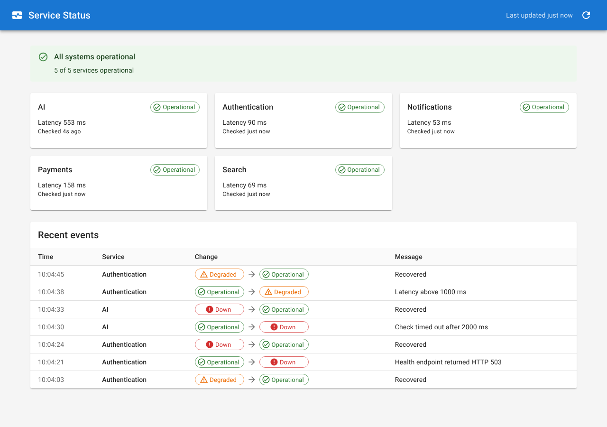

# Service Status Dashboard

A small internal dashboard showing the live status of five services (Authentication, Payments, Notifications, Search, AI). The service data is simulated; everything else (polling, timeouts, staleness, API, UI states) works as it would against real services.

Built as the first iteration of a tool teammates would keep developing: one view done well, a clear API contract, and seams where the real implementations plug in.



## Run it

**Requirements:** Node.js 22.12 or newer (`.nvmrc` included).

```bash
npm ci
npm run dev
```

Open **http://localhost:5173**. `npm run dev` starts both processes:

| Process              | URL                   | Notes                                                                  |
| -------------------- | --------------------- | ---------------------------------------------------------------------- |
| Web (Vite + React)   | http://localhost:5173 | Forwards `/api/*` to the API, so the browser sees one origin (no CORS) |
| API (Node + Fastify) | http://localhost:3100 | Starts the poller; readable logs in the terminal                       |

If port 3100 is taken: `PORT=3200 API_URL=http://127.0.0.1:3200 npm run dev`.

### Other commands

```bash
npm test             # all tests (shared, server, web)
npm run typecheck    # TypeScript, all packages
npm run lint         # ESLint
npm run format       # Prettier
npm run build        # production build of the web app (web/dist)

npm run dev -w @ssd/server   # API only
npm test -w @ssd/web         # one package's tests
```

### Configuration

All optional; defaults shown. See `server/.env.example` and `web/.env.example`.

| Variable                   | Default                 | Meaning                                                      |
| -------------------------- | ----------------------- | ------------------------------------------------------------ |
| `PORT`                     | `3100`                  | API port                                                     |
| `POLL_INTERVAL_MS`         | `10000`                 | How often the server checks every service                    |
| `CHECK_TIMEOUT_MS`         | `2000`                  | A check slower than this is cut off and recorded as **down** |
| `DEGRADED_LATENCY_MS`      | `1000`                  | A successful check slower than this is **degraded**          |
| `STALE_AFTER_MS`           | `30000`                 | A result older than this is reported as **unknown**          |
| `EVENT_HISTORY_LIMIT`      | `100`                   | Status changes kept in memory                                |
| `LOG_LEVEL`                | `info`                  | `debug` also logs every polling round                        |
| `VITE_REFRESH_INTERVAL_MS` | `15000`                 | How often the browser asks the API (read when Vite starts)   |
| `API_URL`                  | `http://127.0.0.1:3100` | Where the Vite dev server forwards `/api`                    |

Invalid server settings stop startup with a clear message (for example, a timeout that isn't shorter than the poll interval).

## How it works

```
                  every 10 s                          every 15 s
 ┌───────────┐   (one round,    ┌───────────────┐    GET /api/services   ┌───────────┐
 │  Poller   │──  all services ─▶│  Status store │◀── routes only read ───│  Browser  │
 │           │    in parallel)  │  (in memory)  │                        │ (React)   │
 └─────┬─────┘                  └───────────────┘                        └───────────┘
       │ HealthChecker (simulated today; swap for real HTTP checks)
       ▼
 Auth · Payments · Notifications · Search · AI
```

**Collecting data is separate from serving it.** The poller checks the services on its own schedule and saves the results; API requests only read what was saved. So 100 open dashboards still mean 5 checks every 10 s, a slow service never slows the API down, and the page always loads fast. The cost: data can be up to one poll interval old, which is why every card shows when it was last checked.

**Failure handling, end to end:**

| What fails             | What happens                                                                                                                 |
| ---------------------- | ---------------------------------------------------------------------------------------------------------------------------- |
| A service is slow      | Over 1 s → **degraded**; over 2 s → check aborted, **down** ("Check timed out after 2000 ms")                                |
| A check throws         | **down** with the error message; other services are unaffected (`Promise.allSettled`)                                        |
| The poller stops       | Results go past 30 s and read as **unknown** (grey), never a stale green; `GET /health` returns 503                          |
| The API is unreachable | Browser keeps the last data with a warning and Retry; after `staleAfterMs` (sent by the server) every card shows **unknown** |
| Bad request            | One error shape everywhere: `{ "error": { "code", "message", "requestId" } }`                                                |

### API

| Endpoint                   | Returns                                                                                                                            |
| -------------------------- | ---------------------------------------------------------------------------------------------------------------------------------- |
| `GET /api/services`        | All services, the overall (worst) status, and the server's `staleAfterMs` / `pollIntervalMs`                                       |
| `GET /api/services/:id`    | One service; `404 SERVICE_NOT_FOUND` if unknown                                                                                    |
| `GET /api/events?limit=50` | Recent status changes, newest first (`limit` 1–100, else `400 VALIDATION_ERROR`)                                                   |
| `GET /health`              | `200` if the poller completed a round recently, `503` otherwise (also for the first moments after startup, before the first round) |

Every response has an `x-request-id` header (a caller's safe ID is reused, otherwise a UUID), and the same ID is on every log line for that request.

### Project layout

```
shared/   zod schemas for the API contract + overall-status rules (used by both sides)
server/   Fastify app, poller, HealthChecker (simulated), in-memory repository
web/      Vite + React + MUI dashboard
```

npm workspaces in one repository: the frontend imports the same schemas the server validates against, so a contract change fails typecheck in the same commit.

## Decisions and tradeoffs

- **One view, all its states.** Operators need everything at a glance during an incident. Time went into loading, error, stale and empty states and accessibility rather than more pages.
- **In-memory store behind a `StatusRepository` interface.** Current status is short-lived data refreshed every poll, so persisting it adds nothing. Redis would be the next step for several instances; Postgres for history (uptime, incidents). The interface is async so either fits.
- **Polling instead of push (SSE/WebSockets).** Simple, works through any proxy, easy to reason about. Moving to Server-Sent Events would change one hook and one route.
- **The server is the source of truth for timing.** The browser uses the `staleAfterMs` it receives rather than a copy that could drift.
- **zod schemas shared by server and client.** One definition per shape: the server validates and serializes with it, the client parses every response so a mismatch fails loudly instead of rendering broken data.
- **`unknown` ranks above `operational` but below `degraded`.** Data we can't confirm must not look healthy, but missing data isn't proof of an outage.
- **MUI** for accessible, consistent components quickly. Cost: a larger bundle and Emotion's runtime styling (about 174 kB of gzipped JavaScript today, mostly MUI and React); worth revisiting if performance mattered.
- **TanStack Query** for polling, keeping data on failure and pausing in hidden tabs, instead of a hand-written hook.
- **TypeScript 6.0, not 7.** typescript-eslint doesn't support 7 yet.
- **The server runs through `tsx`** (no compile step). For production I'd bundle it (esbuild/tsup) and run plain `node`.
- **Deliberately not built:** authentication, Docker, CI/CD, a database, charts, per-service settings pages. Useful later, not the best use of a first iteration.

### Accessibility

Status is always an icon **and** a text label; status chips share a width so lists line up; error text uses the darker palette shade for contrast; the overall banner and table have proper landmarks/headings (the table has a caption); status changes are announced politely to screen readers ("Payments is now Down."); the refresh button has an accessible name.

## Assumptions

- Five services with fixed definitions (`server/src/services.ts`); in production they'd come from a service catalog.
- Health checks are simulated with realistic per-service behavior (AI is slow and spiky, Payments sometimes hangs). Status changes are deliberately frequent so a demo shows them; tune in `server/src/health/simulatedHealthChecker.ts`.
- One API instance. With several, each would run its own poller (see next steps).
- Internal tool on a trusted network: no auth, no rate limiting.

## Known gaps

- On narrow screens the events table scrolls sideways inside its card; a stacked list would read better on phones.
- No status history beyond the last 100 changes, and none survives a restart.
- Staleness is computed when results are read, so "went stale" is not recorded as an event.

## With another day

1. **Real health checks:** an `HttpHealthChecker` calling each service's `/health`, behind the existing interface.
2. **Avoid flapping:** require N consecutive failures before changing status; per-service intervals and thresholds by criticality.
3. **Several instances:** Redis-backed repository and a single elected poller (or a separate worker).
4. **History:** store results in Postgres; uptime % and an incident timeline per service.
5. **Mobile events list**, and Server-Sent Events for instant updates.
6. **CI** (typecheck, lint, test on every PR) and a production build of the server.
7. **Metrics:** check latency and status per service exposed for Prometheus; alerting hooks.

## How AI was used

AI (Claude) was used throughout as a pair: turning the brief into an architecture and scope, sketching the screens in Figma, scaffolding, writing code and tests in small reviewed steps, and running checks. Each step was planned first, discussed, verified (typecheck, lint, tests, a live run with screenshots) and committed separately.

AI output was wrong several times; these were caught by verification rather than trust:

- **Layout bug the tests didn't catch.** A screen-reader-only style used `width: 1`, which MUI's `sx` treats as 100%, making the page scroll sideways. Found by looking at real screenshots, not by tests.
- **Outdated APIs.** Icon imports used names MUI 9 had renamed (caught by typecheck); a Fastify logging option had been deprecated (caught by a warning in test output and fixed with the new form).
- **Version mismatch.** The newest TypeScript (7) isn't supported by typescript-eslint; checked the peer dependencies before pinning 6.0.
- **Environment issue, not a code bug.** Every API call returned HTTP 406 locally: another app owned port 3000. The status code (which this API never sends) pointed to the cause; the fix was the default port and proxying to `127.0.0.1`, not working around it.

## Time

Main time was about understanding the problem, discussing different approaches and planning.  After decisions were made I created a preliminar Figma design to help me have a graphic idea of how the application should look. Then I plan the steps to excuete.
After plan was set, I executed it step by step.
Each step matched a commit: scaffold → shared contract → backend → frontend → docs.
I can say that the test took me about 60 - 75 minutes.
